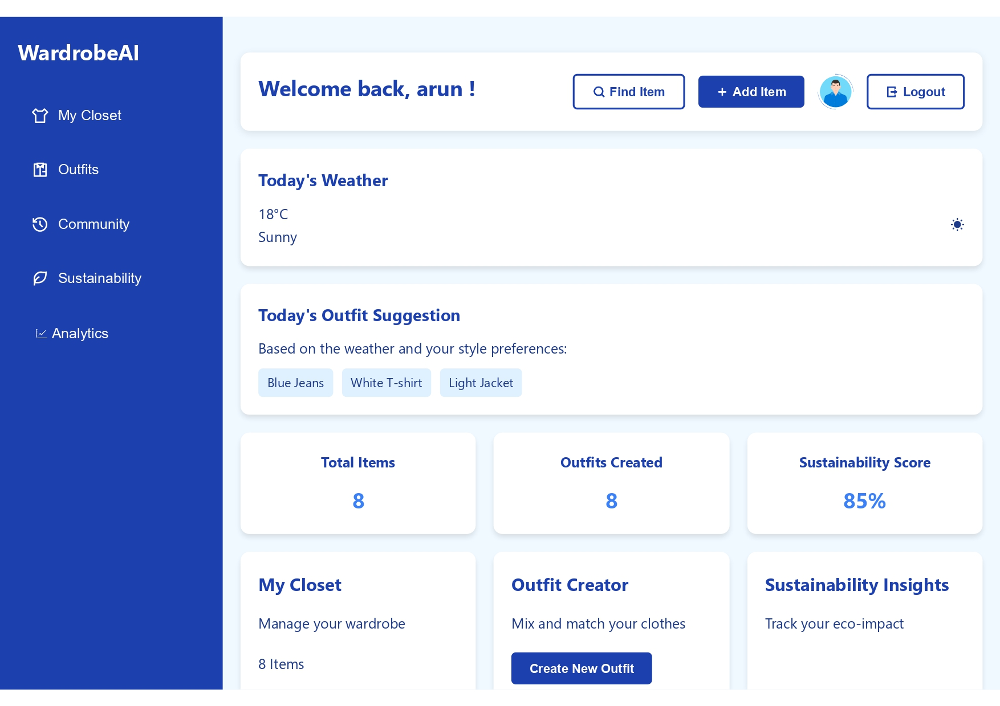

## Overview

Digital Closet is a comprehensive platform designed to help users organize and manage their wardrobe efficiently. The application provides features for tracking clothing items, analyzing usage patterns, and generating personalized outfit suggestions.

## Key Features

### 1. Wardrobe Management
- **Item Tracking**: Add and catalog clothing items with details like brand, color, size, and category
- **Usage Analytics**: Track how often items are worn and identify favorites
- **Organization**: Organize clothes by category, season, or custom collections
- **Image Support**: Upload images of items for visual reference

### 2. Outfit Suggestions
- **Smart Recommendations**: AI-powered outfit combination suggestions based on colors and styles
- **Weather Integration**: Outfit suggestions based on current and forecasted weather
- **Occasion-Based**: Special outfit ideas for different events and occasions

### 3. Community Features
- **Item Exchange**: Donate or exchange items with other users in your community
- **Clothing Marketplace**: Buy, sell, or trade items with fellow fashion enthusiasts
- **Social Sharing**: Share outfit ideas and styling tips with friends
- **Trending Styles**: Discover popular combinations and trending fashion items

## Technology Stack

- **Backend**: Node.js with Express.js framework for robust API development
- **Database**: MongoDB for flexible and scalable data storage
- **Frontend**: HTML, CSS, and JavaScript for responsive user interface
- **Hosting**: Deployed on Render for reliable uptime

## Architecture Highlights

The application follows the MVC (Model-View-Controller) architecture with:
- RESTful API endpoints for all operations
- Session-based authentication using JWT tokens
- Real-time data synchronization for item updates
- Optimized image storage and compression

## Challenges & Solutions

**Challenge**: Managing large image datasets for wardrobe items
**Solution**: Implemented image optimization techniques and CDN integration for faster loading

**Challenge**: Accurate outfit pairing recommendations
**Solution**: Developed a color matching algorithm that considers fabric type, season, and current trends

## Future Enhancements

- Machine learning integration for improved style recommendations
- AR try-on feature to visualize outfits
- Integration with fashion e-commerce platforms
- Mobile application for on-the-go wardrobe management
- Advanced reporting and trend analysis dashboard

## Deployment

The application is currently live and deployed on Render. Users can access it at [digital-closet.onrender.com](https://digital-closet.onrender.com/) to start organizing their wardrobes today.
