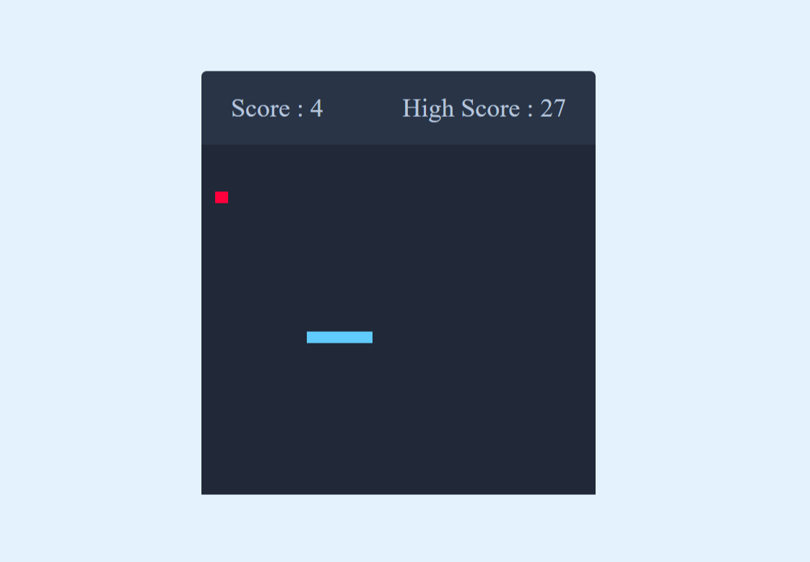

## Overview

A classic implementation of the timeless Snake Game, built with vanilla JavaScript. This interactive game brings back nostalgic gameplay while implementing modern web technologies and smooth animations.

## Game Mechanics

### Core Gameplay
- **Snake Movement**: Control the snake using arrow keys or WASD
- **Food Collection**: Eat food items to grow and score points
- **Collision Detection**: Avoid walls and colliding with your own tail
- **Progressive Difficulty**: Speed increases as your snake grows longer

### Scoring System
- **Points Per Food**: 10 points for each food item consumed
- **Bonus Points**: Extra points for consecutive food pickups
- **High Score Tracking**: Persistent high scores using localStorage
- **Leaderboard**: Compare scores with friends

## Features

### Visual Design
- **Modern Graphics**: Clean, minimalist interface with smooth animations
- **Theme Support**: Light and dark mode themes
- **Smooth Movement**: 60 FPS gameplay for fluid snake motion
- **Visual Feedback**: Impact animations and color transitions

### User Experience
- **Easy Controls**: Intuitive keyboard controls
- **Pause Feature**: Pause and resume gameplay anytime
- **Mobile Friendly**: Touch controls for mobile devices
- **Statistics**: View game duration and performance metrics

### Technical Implementation

#### Game Engine
- **Canvas API**: Used for rendering game graphics
- **Game Loop**: 60 FPS frame rate for smooth gameplay
- **Collision Detection**: Pixel-perfect collision checking
- **Physics**: Smooth acceleration and smooth snake movement

#### Code Structure
```javascript
// Game components
- Snake class: Manages snake position and growth
- Food class: Handles food spawning and positioning
- Game Manager: Controls game state and logic
- Input Handler: Processes keyboard and touch inputs
```

## Gameplay Features

### Game Modes
- **Classic Mode**: Traditional snake gameplay
- **Time Attack**: Complete objectives within time limit
- **Zen Mode**: Endless gameplay with no time pressure
- **Challenge Mode**: Special rules and obstacles

### Difficulty Levels
- **Easy**: Slower speed, larger starting area
- **Medium**: Standard speed and difficulty
- **Hard**: Faster speed with tight controls
- **Expert**: Maximum speed with special obstacles

## Performance Optimization

- **Efficient Rendering**: Only redraw changed elements
- **Memory Management**: Proper cleanup of game objects
- **Mobile Optimization**: Reduced animation complexity on lower-end devices
- **Network**: No server requirements - pure client-side game

## Browser Compatibility

- Modern browsers (Chrome, Firefox, Safari, Edge)
- Mobile browsers (iOS Safari, Android Chrome)
- Tablet support with touch controls
- Progressive enhancement for older browsers

## Accessibility

- **Keyboard Navigation**: Full keyboard control support
- **Color Contrast**: High contrast graphics for visibility
- **Touch Friendly**: Large touch targets for mobile
- **Screen Reader Support**: Game status announcements

## Statistics Tracking

- **Games Played**: Total number of games
- **Total Score**: Combined points from all games
- **Best Score**: Highest score achieved
- **Play Time**: Total time spent playing
- **Average Score**: Mean score across all games

## Future Enhancements

- Multiplayer mode via WebSocket
- Power-ups and special items
- Different map layouts and themes
- Sound effects and background music
- Achievements and badges system
- Online leaderboard with cloud sync

## Technical Challenges Solved

**Challenge**: Smooth real-time movement at high speeds
**Solution**: Implemented frame-based movement with delta time calculations

**Challenge**: Responsive design across devices
**Solution**: Dynamic canvas sizing and touch event handling

**Challenge**: Collision detection accuracy
**Solution**: Implemented bounding box collision with early exit optimization

## Play Now

The game is fully functional and deployed. Give it a try at [Game Link](https://66c38fd934adde11bdce8bcd--eclectic-muffin-fc3b45.netlify.app/) and challenge yourself to beat the high scores!

---

*Built with vanilla JavaScript - No frameworks, just pure coding fun!*
