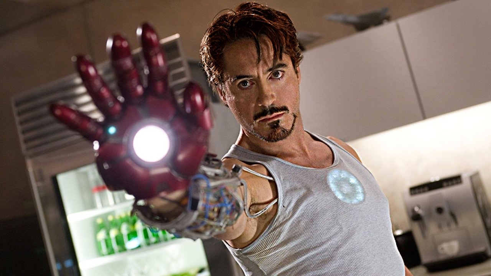
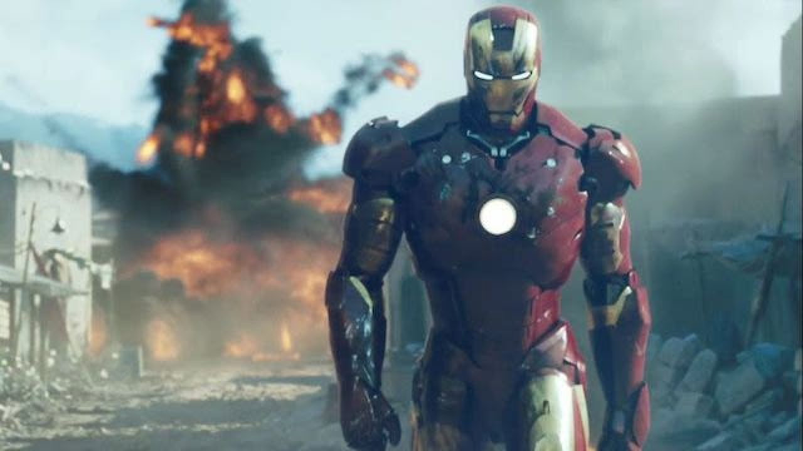
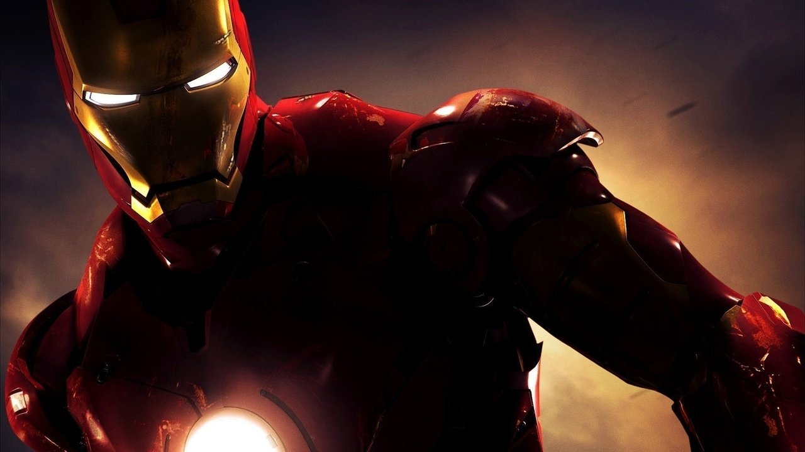

## The Guy Who Made Being Smart Cool

Before the multiverse, time travel, and thirty different Marvel sequels, there was just AC/DC blasting in a desert Humvee, a glass of scotch, and a guy who made building things look like the coolest job in the world.

Growing up, every other superhero was either born a god or cursed by an accident:

- **Superman** was an alien from another galaxy.
- **Batman** was brooding in a dark cave with family trauma.
- **Spider-Man** got bitten by a radioactive bug.

Then came Tony Stark. No magical powers. No secret alien blood. Just a human brain, tons of confidence, and hands that knew how to turn a pile of junk into a weapon of the future.

<figure class="my-8 overflow-hidden rounded-xl border border-skin-line/20 shadow-lg">
  
  <figcaption class="px-4 py-2.5 text-center font-mono text-xs text-skin-base/60 bg-skin-card/40 border-t border-skin-line/10">
    Tinkering in the garage at 3 AM — testing the Mark II repulsor with a glowing chest reactor.
  </figcaption>
</figure>

---

## What Made Tony Stark Different?

In most stories, heroes try hard to be humble, pure, and quiet. Tony Stark did the exact opposite. He walked into every room like he owned the building.

<Comparison>
  <ComparisonSide label="The Old Superhero Rulebook">
    - Hide behind fake glasses or a secret name.
    - Cry about your heavy responsibility.
    - Wear dark capes and stay in the shadows.
    - Always follow orders and play by the rules.
  </ComparisonSide>
  <ComparisonSide label="The Tony Stark Playbook">
    - Stand in front of every camera and admit who you are.
    - Play loud rock music in your lab while building rockets.
    - Fix your own mistakes with your own hands.
    - If the rules don't work, build a suit and break them.
  </ComparisonSide>
</Comparison>

<QuoteBlock author="Tony Stark" source="Iron Man (2008)" position="left">
  Sometimes you gotta run before you can walk.
</QuoteBlock>

---

## The Journey of Tony Stark

The beauty of the 2008 film is that it is a simple, human story about a man waking up to reality:

<Timeline
  items={[
    {
      date: "The Afghan Cave",
      title: "Building from Scraps",
      description:
        "Hit by his own company's missile. Trapped underground with a car battery in his chest, Tony refuses to die. He hammers out the Mark I out of scrap missile parts.",
    },
    {
      date: "The Malibu Garage",
      title: "Trial, Error, and Fire",
      description:
        "Back home, he doesn't rest. He turns his garage into an inventor's playground, testing boot thrusters, crashing into ceilings, and arguing with his robot arm Dummy.",
    },
    {
      date: "The Gulmira Flight",
      title: "First Real Mission",
      description:
        "The red-and-gold Mark III takes flight. Tony flies halfway across the world to protect innocent villagers, destroying a tank with a single mini-missile.",
    },
    {
      date: "The Rooftop Fight",
      title: "Facing His Past",
      description:
        "Tony takes on Obadiah Stane's giant Iron Monger suit. Running on his old weak reactor, he relies on smarts rather than raw strength to win.",
    },
    {
      date: "The Final Words",
      title: "'I am Iron Man'",
      description:
        "SHIELD hands him an alibi card. Tony looks at the reporters, tosses the script aside, and says the words that changed superhero movies forever.",
    },
  ]}
/>

---

<figure class="my-8 overflow-hidden rounded-xl border border-skin-line/20 shadow-lg">
  
  <figcaption class="px-4 py-2.5 text-center font-mono text-xs text-skin-base/60 bg-skin-card/40 border-t border-skin-line/10">
    The legendary Gulmira scene — one shot, one missile, zero hesitation.
  </figcaption>
</figure>

---

## The Evolution of the Armor

Watching Tony build things was half the fun of the movie. You felt the weight of every bolt, circuit, and weld:

<Tabs>
  <TabItem label="Mark I">
    Rough, heavy, and dangerous. Built in secret inside a cave with hammer and fire. It ran on a mini arc reactor and shot flames, barely lasting long enough to get him out alive.
  </TabItem>
  <TabItem label="Mark II">
    Pure silver prototype. Aerodynamic, sleek, but unpainted. Tony pushed it as high as it could go into the night sky until frost froze the flight flaps.
  </TabItem>
  <TabItem label="Mark III">
    The classic red and gold. Made from a gold-titanium alloy so it wouldn't freeze, equipped with shoulder darts, forearm missiles, and repulsors.
  </TabItem>
  <TabItem label="Dummy the Robot">
    The goofy robotic arm with a fire extinguisher. Always spraying Tony at the worst possible second, yet Tony kept him around like an annoying little brother.
  </TabItem>
</Tabs>

<Callout type="insight" title="Why Robert Downey Jr. Was Perfect">
  In 2007, Marvel took a massive gamble hiring Robert Downey Jr. He had been through real trouble, public falls, and hard times in his own life. That real-life journey gave Tony Stark real heart. When Tony looks at the press after escaping captivity and eats a cheap cheeseburger, that's not just acting—it's real human relief.
</Callout>

---

<figure class="my-8 overflow-hidden rounded-xl border border-skin-line/20 shadow-lg">
  
  <figcaption class="px-4 py-2.5 text-center font-mono text-xs text-skin-base/60 bg-skin-card/40 border-t border-skin-line/10">
    Practical suit craftsmanship — you could feel the cold metal, oil stains, and weight of the suit.
  </figcaption>
</figure>

---

## What Made the 2008 Film Special

<Progress label="Practical Armor & Real Weight" value={98} max={100} />
<Progress label="Fun, Fast Dialogue & Swagger" value={100} max={100} />
<Progress label="Garage Tinkering & Rock Soundtrack" value={100} max={100} />
<Progress label="Secret Identity Hiding" value={0} max={100} />

<QuoteBlock author="Tony Stark" source="Final Press Conference" position="left">
  The truth is... I am Iron Man.
</QuoteBlock>

<Spoiler label="The Scene After the Credits">
  After the credits, Nick Fury walks out of the dark inside Tony's living room and mentions the "Avengers Initiative". Back in 2008, nobody knew if it would actually work. That short 30-second clip started the biggest cinematic universe in movie history.
</Spoiler>

---

## Why It Still Matters

*Iron Man* proved that being smart is not boring. 

Tony Stark made curious minds, tinkering in garages, and fixing things with science look exciting. He was messy, he had flaws, and he made big mistakes. But when things went south, he didn't wait for someone else to save the day—he picked up a wrench and built the solution himself.
