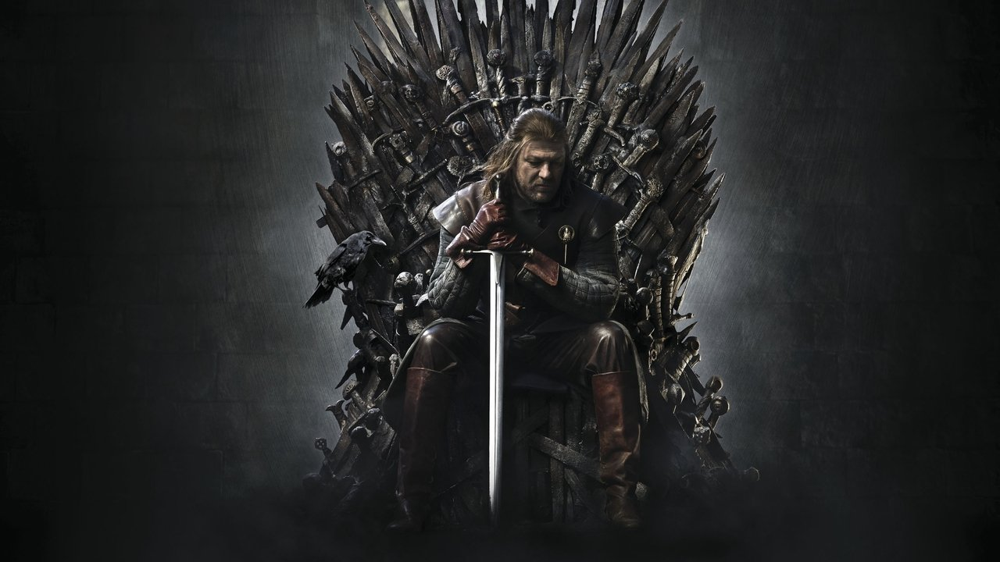
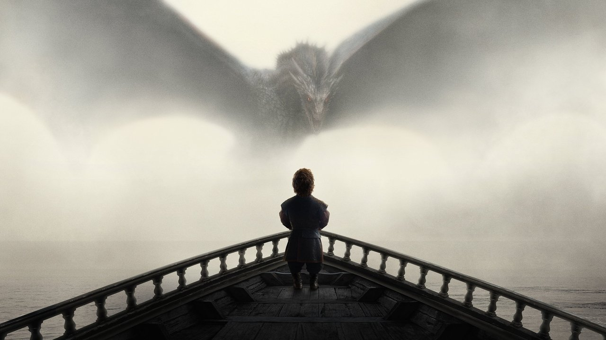
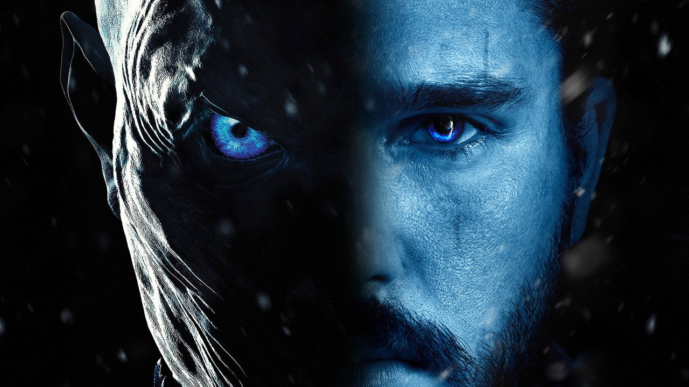
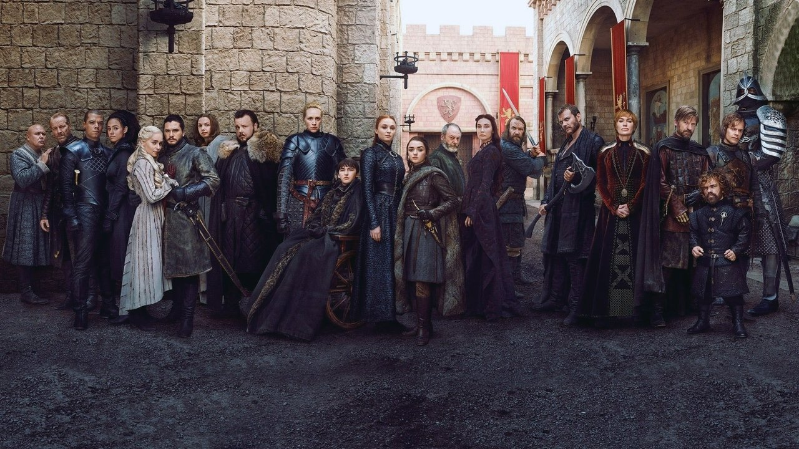
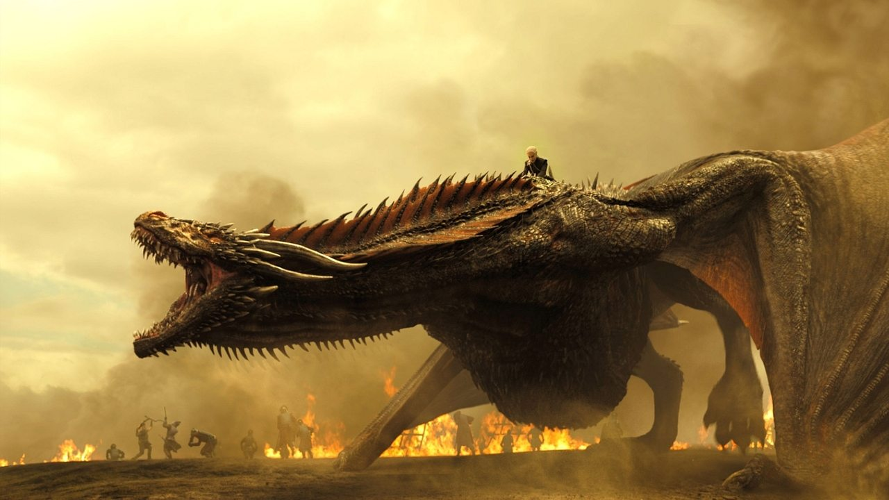

## The Monoculture and the Iron Seat

For eight years, the world revolved around a rusted iron chair forged from a thousand surrendered swords. 

Before streaming algorithms segmented culture into personalized echo chambers, *Game of Thrones* was the last true global monoculture. On Sunday nights, millions of people across continents held their breath simultaneously. Offices, university dining halls, and social feeds ground to a halt to debate succession law, high treason, and whether winter would ever actually come.

<figure class="my-8 overflow-hidden rounded-xl border border-skin-line/20 shadow-lg">
  
  <figcaption class="px-4 py-2.5 text-center font-mono text-xs text-skin-base/60 bg-skin-card/40 border-t border-skin-line/10">
    Sean Bean as Lord Eddard Stark — where honor collided with political mortality.
  </figcaption>
</figure>

What made the show an undeniable phenomenon—especially across its immortal first four seasons—was not dragons, ice zombies, or high-budget siege warfare. It was the brutal demystification of power.

<QuoteBlock author="Cersei Lannister" source="Game of Thrones, Season 1" position="left">
  When you play the game of thrones, you win or you die. There is no middle ground.
</QuoteBlock>

In typical high fantasy, moral goodness acts as invisible armor. Aragorn is good, so kingship is his birthright. Frodo is pure, so the ring cannot immediately corrupt his heart. 

George R.R. Martin and showrunners David Benioff and D.B. Weiss inverted the formula: in Westeros, virtue without political leverage is an execution warrant.

---

## The Anatomy of an Epic: From Masterpiece to Ruin

The eight-season journey of *Game of Thrones* represents both the highest peak prestige television ever climbed and one of the most instructive cautionary tales in modern storytelling:

<Timeline
  items={[
    {
      date: "Season 1 (2011)",
      title: "The Death of Honor",
      description:
        "Ned Stark searches for truth in a court built on whispers. When Illyn Payne's sword falls at the Great Sept of Baelor, television history divides into before and after.",
    },
    {
      date: "Season 2 – 3 (2012–2013)",
      title: "The Chessboard Bleeds",
      description:
        "The War of the Five Kings, Stannis at Blackwater Bay, and the haunting acoustic notes of The Rains of Castamere closing the Red Wedding.",
    },
    {
      date: "Season 4 (2014)",
      title: "The High Water Mark",
      description:
        "Tyrion Lannister's courtroom reckoning, the tragic duel between the Red Viper and the Mountain, and the unraveling of House Lannister's patriarch.",
    },
    {
      date: "Season 5 – 6 (2015–2016)",
      title: "The Rise of Spectacle",
      description:
        "The adaptation overtakes Martin's published manuscripts. Hardhome and The Battle of the Bastards deliver unprecedented visual choreography while dialogue starts thinning.",
    },
    {
      date: "Season 7 – 8 (2017–2019)",
      title: "The Expedited Collapse",
      description:
        "Geography dissolves, armies regenerate without logistical explanation, and character trajectories cultivated across a decade are resolved in haste.",
    },
  ]}
/>

---

## Sociological vs. Psychological Storytelling

The fundamental reason the early seasons felt like historical realism while the final seasons felt like a checklist comes down to Zeynep Tufekci's famous distinction between sociological and psychological writing.

<Comparison>
  <ComparisonSide label="The Golden Age (Seasons 1–4)">
    **Sociological Realism**
    - Characters act within institutional constraints: debts to the Iron Bank, food reserves for winter, broken treaties, marriage alliances.
    - Decisions trigger unforgiving causal chains. If you trust Littlefinger, you get betrayed. If you execute Karstark, your army mutinies.
    - Tension is generated by two people whispering in a candlelit chamber over cups of Arbor red.
  </ComparisonSide>
  <ComparisonSide label="The Late Era (Seasons 7–8)">
    **Hollywood Spectacle**
    - Plot convenience supersedes the world's established rules: fast-travel across continents in a single afternoon, endless dragon fire, infinite plot armor.
    - Actions happen because the script needs a dramatic moment, not because the characters logically arrived there.
    - Dialogue is reduced to witty one-liners and quips rather than philosophical ideological clash.
  </ComparisonSide>
</Comparison>

<figure class="my-8 overflow-hidden rounded-xl border border-skin-line/20 shadow-lg">
  
  <figcaption class="px-4 py-2.5 text-center font-mono text-xs text-skin-base/60 bg-skin-card/40 border-t border-skin-line/10">
    Tyrion Lannister gazing at Drogon rising through the Valyrian mist — when myth entered political reality.
  </figcaption>
</figure>

<Callout type="insight" title="The Power of the Small Room">
  The greatest scenes in *Game of Thrones* never cost fifty million dollars. They were Tywin Lannister butchering a stag while interrogating Jaime about legacy; Varys and Littlefinger debating the nature of the realm before the empty throne; and Robert Baratheon asking Ned Stark how long a lie can hold a kingdom together.
</Callout>

---

## The Great Players of the Realm

<Tabs>
  <TabItem label="Tyrion Lannister">
    A mind forged by survival. Denied martial glory and paternal affection due to his dwarfism, Tyrion turned intellect into his battleaxe. His defense of King's Landing at the Blackwater and his explosive trial speech remain Peter Dinklage's crowning masterclasses.
  </TabItem>
  <TabItem label="Cersei Lannister">
    A masterstudy in narcissistic cruelty and political short-sightedness. Cersei believed she was her father Tywin in a gown, but she had all of his ruthlessness and none of his strategic restraint. Every trap she laid—from arming the High Sparrow to alienating the Tyrells—eventually sprang on herself.
  </TabItem>
  <TabItem label="Jaime Lannister">
    The Kingslayer whose honor was destroyed by the very act that saved half a million innocents from wildfire. His bathhouse confession to Brienne of Tarth at Harrenhal turned one of television's vilest villains into its most tragic, conflicted knight.
  </TabItem>
  <TabItem label="Daenerys Targaryen">
    Born in exile amidst storms and fear, her journey from terrified bride to liberator of Slaver's Bay was electric. Her tragedy was always present in the margins: the belief in her divine right to burn anyone standing between her and destiny.
  </TabItem>
</Tabs>

---

<QuoteBlock author="Lord Petyr Baelish" source="Game of Thrones, Season 3" position="left">
  Chaos isn't a pit. Chaos is a ladder. Many who try to climb it fail, and never get to try again. The fall breaks them. And some are given a chance to climb, but they refuse. They cling to the realm, or the gods, or love. Illusions. Only the ladder is real. The climb is all there is.
</QuoteBlock>

---

## Two Halves of a Divided Realm

  <figure class="overflow-hidden rounded-xl border border-skin-line/20 shadow-md">
    
    <figcaption class="px-3 py-2 text-center font-mono text-[11px] text-skin-base/60 bg-skin-card/50">
      Fire and ice: The living versus the ancient cold.
    </figcaption>
  </figure>
  <figure class="overflow-hidden rounded-xl border border-skin-line/20 shadow-md">
    
    <figcaption class="px-3 py-2 text-center font-mono text-[11px] text-skin-base/60 bg-skin-card/50">
      The Great Houses assembled in the courtyard of King's Landing.
    </figcaption>
  </figure>

---

## Evaluating the Legacy

Despite the sour taste left by its truncated final season, *Game of Thrones* permanently transformed the ambition, production scope, and adult complexity of television:

<Progress label="Dialogue & Political Intrigue (Seasons 1-4)" value={98} max={100} />
<Progress label="Cinematography, Score & Visual Production" value={97} max={100} />
<Progress label="Cultural Impact & Global Monoculture" value={100} max={100} />
<Progress label="Narrative Climax & Resolution (Season 8)" value={32} max={100} />

<figure class="my-8 overflow-hidden rounded-xl border border-skin-line/20 shadow-lg">
  
  <figcaption class="px-4 py-2.5 text-center font-mono text-xs text-skin-base/60 bg-skin-card/40 border-t border-skin-line/10">
    The Spoils of War — the terrifying apex of dragon fire and visual spectacle.
  </figcaption>
</figure>

<Spoiler label="The Burning of King's Landing & Bran the Broken">
  Daenerys burning King's Landing and Bran becoming King were almost certainly George R.R. Martin's planned literary endpoints. The failure of Season 8 was not the destination, but the complete absence of connective tissue. In the books, a descent into madness or tragic tyranny takes hundreds of pages of grief, isolation, paranoia, and moral compromise. In the show, it occurred in the space of two episodes because the production was eager to move on.
</Spoiler>

---

## Why Westeros Still Endures

Even with its bruised finale, you cannot talk about twenty-first-century culture without *Game of Thrones*. Ramin Djawadi's cello suites (*Light of the Seven*, *The Night King*), the sheer audacity of the Red Wedding, and the haunting realization that human beings are capable of building paradise if only they didn't desire the crown so desperately—these remain indelible.

It taught an entire generation that in politics as in life, reality does not yield to intentions. The world belongs to those who understand its leverage, and the throne, in the end, cuts everyone who sits upon it.
